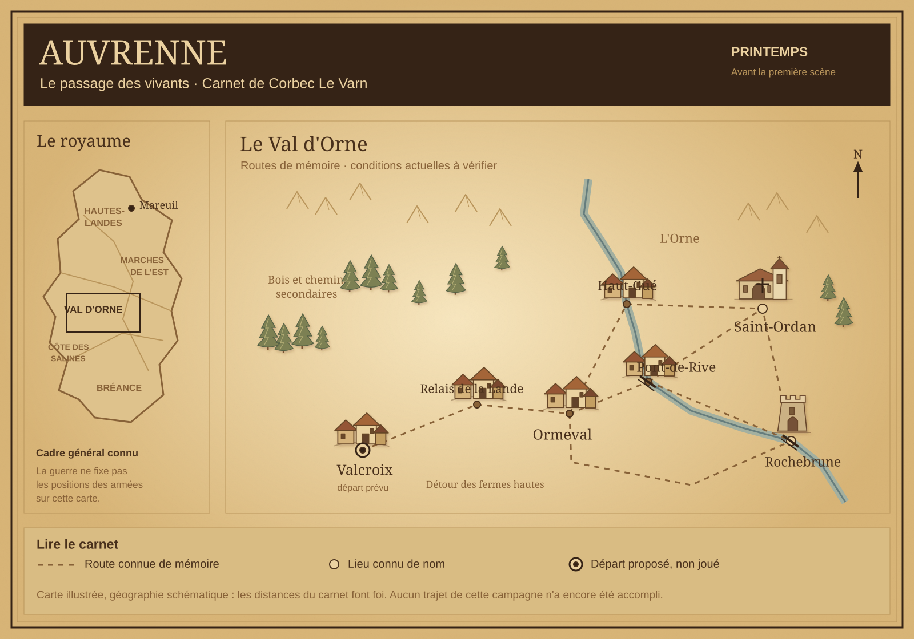

# Auvrenne — Le passage des vivants

> Carnet public de préparation. Rien dans ce document ne constitue un événement déjà joué. Les noms et détails ajoutés après le questionnaire sont des propositions de préparation, modifiables avant le lancement.

## Les choix validés

| Élément | Choix |
| --- | --- |
| Univers | Royaume médiéval réaliste, sans magie |
| Royaume | Auvrenne |
| Guerre | Plusieurs provinces se sont soulevées contre le souverain |
| Ton | Sombre et brutal, avec des conséquences durables |
| Combats | Réguliers lorsque la situation le justifie, avec des alternatives crédibles |
| Résolution | Dés pour les actions réellement incertaines |
| Saison | Printemps : pluies, crues et chemins difficiles |
| Personnage | Corbec Le Varn, mercenaire indépendant de 46 ans, aguerri |
| Spécialité | Discrétion : infiltration, observation, intervention au bon moment |
| Faiblesse | Goût du risque lorsque le gain paraît suffisant |
| Motivation | Dette de vie envers Alix de la Noue |
| Limites morales du personnage | Aucune ligne rouge fixée à l’avance ; les actes auront des conséquences |
| Relation avec Alix | Tendue : elle désapprouve son métier, mais fait appel à lui |
| Situation | Au repos après une mission payée, quelques économies, libre de partir |
| Équipement validé | Dague, arc court, bagage léger et mule de bât |
| Réputation locale | Visage oublié ; quelques anciens pourraient le reconnaître |
| Mission proposée | Escorter les patients d’Alix et plusieurs familles vers un monastère |
| Connaissance régionale | Anciens chemins de campagne militaire ; état actuel inconnu |
| Carnet et site | Charte médiévale chaleureuse de la version précédente : bois sombre, parchemin doré, laiton, portraits et objets illustrés |

## Un royaume qui se fracture

Auvrenne est un pays de vallées cultivées, de plateaux froids et de villes établies autour des ponts. Le pouvoir royal dépend des péages, des greniers et de l’obéissance de seigneurs capables de lever des hommes.

**Proposition de lore :** le roi Thibaut IV de Mareuil exige depuis plusieurs années des contributions extraordinaires et des levées prolongées. Une coalition de provinces, appelée la Ligue des Provinces, refuse désormais ces demandes et conteste l’autorité des officiers royaux. Les insurgés ne partagent pas tous le même projet.

La guerre ne partage pas le pays entre un camp entièrement juste et un camp entièrement mauvais. Une garnison peut protéger un marché et réquisitionner son grain ; un seigneur rebelle peut défendre ses villages et leur imposer une levée. Leurs actes seront établis par les situations rencontrées.

Des compagnies indépendantes vendent leur service, changent d’employeur ou vivent de prises. **La Compagnie de la Herse** est le nom proposé pour celle que Corbec avait refusé de rejoindre. Elle occupait le village où Alix l’a caché et soigné. Sa présence actuelle n’est pas établie dans le carnet.

La médecine repose sur l’expérience : nettoyer une plaie, poser une attelle, maintenir un malade au chaud. Une blessure sérieuse ne disparaît pas après une nuit ; aucune guérison surnaturelle n’existe.

### Les grandes régions connues

| Région proposée | Ce que Corbec peut en savoir |
| --- | --- |
| Val d’Orne | Vallée centrale de cultures et de passages ; région initiale de l’évacuation |
| Hautes-Landes | Plateaux du nord-ouest, plusieurs seigneuries soulevées |
| Marches de l’Est | Pays de places fortes, de frontières seigneuriales et de routes militaires |
| Côte des Salines | Ports et marais salants ; ravitaillement disputé |
| Terres de Bréance | Provinces du sud, marchés et grands domaines |
| Mareuil | Ville de la couronne, connue de nom ; aucune visite jouée |

La carte du royaume donne un cadre général. Les occupations militaires, les passages sûrs et les intentions des habitants ne sont pas connus par simple lecture de cette carte.

## Corbec Le Varn

Sec et buriné, cheveux grisonnants courts, barbe de quelques jours et regard attentif. Son expérience l’aide à choisir un couvert, attendre un changement de garde et repérer une habitude. Elle ne lui permet pas de disparaître en plein jour ni de vaincre seul n’importe quel adversaire.

Il est équipé pour se déplacer discrètement, pas pour tenir une ligne de bataille. Son arc est utile à courte portée et sa dague exige la proximité ; une protection lourde ou un groupe organisé reste un danger sérieux.

Il a des économies, mais **aucun montant n’est encore fixé**. Le nombre de flèches, les rations et la charge déjà portée par la mule seront arrêtés avant la première dépense ou leur premier emploi à enjeu. Il n’est pas doté d’objets supplémentaires par défaut.

### Relations initiales

**Alix de la Noue — soigneuse civile.** Elle l’a caché et soigné dans un village occupé. Elle désapprouve ses contrats de mercenaire. Sa demande est réelle ; l’acceptation et les conditions appartiennent encore à Corbec. Aucun lien amoureux n’est établi.

Les autres personnages seront connus lors d’une rencontre, par un souvenir explicitement défini ou par un témoignage attribué. Le carnet ne leur invente pas d’emblée une relation avec Corbec.

## L’appel d’Alix

**Information de départ validée :** les combats approchent du village où Alix soigne ses patients. Elle lui demande de l’aider à évacuer les blessés et quelques familles vers un monastère accueillant les victimes des deux camps.

**Noms de préparation proposés :**

- Village d’Alix : **Ormeval**.
- Refuge envisagé : **monastère de Saint-Ordan**.
- Lieu de repos de Corbec : **Valcroix**, départ prévu de la première scène.

Le groupe exact, les moyens de transport disponibles et les conditions réelles d’accueil seront des faits à constater. Le message n’apporte pas la certitude que toutes les routes sont ouvertes ni qu’une place attend chacun.

**Mission : possibilité proposée, pas encore acceptée.** Le questionnaire et cette préparation n’engagent pas Corbec à partir, à promettre sa solde ou à choisir un camp.

## La carte initiale

La carte est schématique. Les distances du tableau font foi ; les tracés ne constituent pas un itinéraire déjà parcouru.

| Lieu | Connaissance au lancement | Ce qui reste inconnu |
| --- | --- | --- |
| Valcroix | Départ prévu, à confirmer lors du lancement | Situation précise de la scène d’ouverture |
| Relais de la Lande | Ancien repère de route connu de Corbec | Occupants et services actuels |
| Ormeval | Village où Alix l’avait soigné ; souvenir ancien | État actuel, patients et préparatifs |
| Pont-de-Rive | Ancien passage repéré pendant une campagne | Contrôle, péage, état du pont |
| Haut-Gué | Passage secondaire dont Corbec connaît l’emplacement | Profondeur actuelle et praticabilité après les pluies |
| Saint-Ordan | Monastère connu de nom ; refuge indiqué par Alix | Places, réserves et conditions d’accueil |
| Rochebrune | Bourg de marché et pont connus de nom | Autorités et ressources accessibles |
| Mareuil | Capitale connue de nom | Situation politique détaillée |

### Distances de référence proposées

| Liaison | Distance par route | Nature du passage connu |
| --- | ---: | --- |
| Valcroix → relais de la Lande | 14 km | Route de vallée |
| Relais de la Lande → Ormeval | 12 km | Chemin rural |
| Ormeval → Pont-de-Rive | 14 km | Route praticable aux voitures en conditions normales |
| Pont-de-Rive → Saint-Ordan | 19 km | Route montante |
| Ormeval → Haut-Gué | 20 km | Chemin secondaire |
| Haut-Gué → Saint-Ordan | 17 km | Piste de coteau |
| Pont-de-Rive → Rochebrune | 18 km | Route du marché |
| Rochebrune → Saint-Ordan | 25 km | Pont du bourg puis chemin de crête |
| Ormeval → Rochebrune | 36 km | Détour par les fermes hautes |

Un marcheur chargé et valide peut viser environ 18 à 24 km par jour sur route convenable. Un convoi comprenant des blessés peut tomber à 8–12 km et devoir s’arrêter plus tôt. Ce sont des repères de préparation, jamais une garantie de déplacement : terrain, état des personnes et décisions priment.

**Aucun déplacement de cette campagne n’a encore été joué.** Les traits de mémoire ne doivent pas devenir des chemins « parcourus » sur le site. Les observations nouvelles ouvriront progressivement les fiches des lieux.

## Rythme et résolution

Le format du moteur reste trente jours fictifs, organisés en soixante sessions indicatives de dix à quinze minutes. Les absences réelles ne font avancer aucune horloge.

L’évacuation est un premier objectif susceptible de réussir rapidement. La suite peut porter sur l’accueil, les soins et la sécurité durable des réfugiés, selon les engagements de Corbec. Une résolution anticipée sera conservée : aucune difficulté supplémentaire ne sera ajoutée pour remplir le calendrier.

**Règle de dés proposée, à confirmer avant le premier jet :** 2d6, avec un modificateur global de −1, 0 ou +1 annoncé selon le savoir-faire, l’approche et les circonstances. À 10 ou plus, l’intention est accomplie ; à 7–9, elle l’est avec un coût annoncé ou une complication cohérente ; à 6 ou moins, l’intention échoue avec une conséquence proportionnée au risque annoncé. Les gestes ordinaires ne demandent pas de jet.

Les dés seront lancés par le joueur ou par un véritable outil de tirage. Aucun résultat aléatoire ne sera inventé. Le goût du risque de Corbec n’est pas un prétexte pour choisir ses actions à sa place.

### Traitement des thèmes

La guerre, les blessures, la peur et les compromis font partie du cadre sombre validé. Cette validation ne vaut pas accord à toutes les descriptions possibles. Par défaut de préparation, les violences sexuelles, la torture détaillée et les sévices graphiques envers les enfants restent hors champ ; toute limite supplémentaire peut être posée avant ou pendant le jeu.

## Direction graphique corrigée

La direction froide initiale est remplacée à la demande du joueur. Le scénario et les choix de Corbec sont conservés.

| Usage | Traitement |
| --- | --- |
| Fond et encadrements | Bois sombre, cuir brun, laiton et lumière chaude, dans la continuité de l’ancienne version Clairval |
| Pages | Parchemin doré et ivoire chaud ; bords usés et ombres douces |
| Encre et accents | Brun sombre, ocre et or patiné |
| Navigation | Menus à miniatures illustrées et titres sur parchemin |
| Personnages | Portraits chaleureux de Corbec et d’Alix, ouvrant leurs fiches |
| Objets | Besace et inventaire illustrés : dague, arc court, mule et bagage ; fiches consultables |
| Carte | Même géographie, mêmes noms et routes ; couleurs réchauffées sans ajout de faits |
| Accessibilité | Texte lisible, contrôles contrastés et décor n’interceptant pas les clics |

## Point d’arrêt

- Cadre du questionnaire : **validé**.
- Lore, noms secondaires, géographie et distances ci-dessus : **préparés comme propositions cohérentes**.
- Sessions jouées : **0**.
- Mission acceptée : **non**.
- Jet réalisé : **aucun**.
- Site de démonstration Clairval : **pas modifié par cette préparation**.
- Déclenchement du jeu : uniquement sur une demande explicite de commencer.

La prochaine étape de production sera d’adapter le site à Auvrenne et d’y intégrer uniquement ce carnet public et la carte autorisée.
