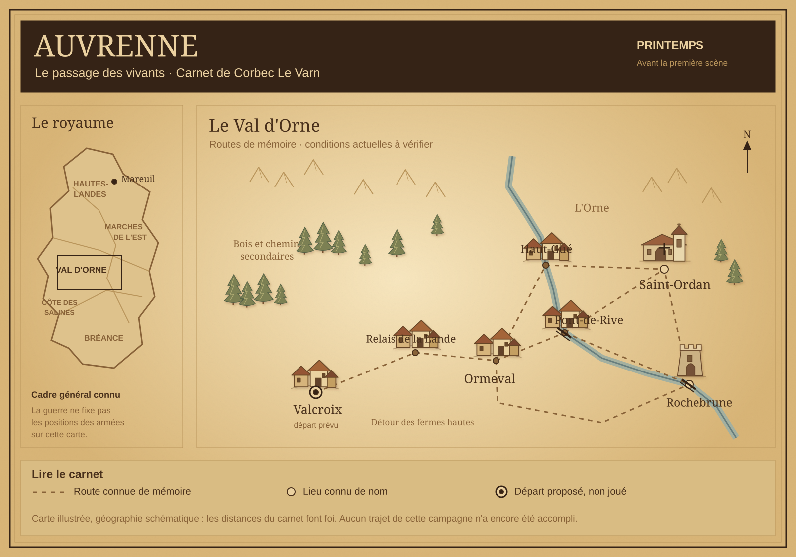

# Moteur RPG

**Un jeu de rôle narratif en conversation, accompagné d’un carnet de campagne illustré.**

[Ouvrir le site](https://delattreb.github.io/Moteur_RPG/) · [Release 1.10.0](https://github.com/delattreb/Moteur_RPG/releases/tag/1.10.0) · [Notes de version](RELEASE_NOTES.md)

*Miniature cliquable de la carte du site Auvrenne. Les repères de ce fond initial représentent des connaissances de départ ; ils ne constituent pas des déplacements joués.*

## Le principe

Le moteur accompagne un joueur et un maître du jeu, humain ou assistant. Le joueur exprime ses intentions ; le MJ présente les situations, résout les actions incertaines selon les règles convenues et fait évoluer le monde.

**Intention → résolution → conséquences → réaction du monde → prochaine décision.**

Le jeu se déroule dans la conversation. Le site permet de consulter le cadre public et la progression enregistrée. GitHub conserve le moteur, ses modèles et ses versions ; les sauvegardes personnelles et les secrets du MJ restent en dehors du dépôt public.

## Nos principes de jeu

- **Le joueur décide.** Le MJ ne choisit pas ses actions, son camp, ses dépenses ou ses engagements à sa place. Des choix numérotés facilitent les réponses ; une action libre reste possible.
- **Une démarche avance vraiment.** Les gestes ordinaires et les questions prévisibles sont regroupés, sans demander une validation à chaque détail.
- **Les conséquences persistent.** Une information obtenue, un objet consommé, une promesse ou une réussite ne sont pas annulés pour prolonger artificiellement l’histoire.
- **Les missions peuvent aboutir.** Une solution efficace est reconnue. Combat, détour, enquête exhaustive et cliffhanger ne sont pas obligatoires.
- **Le monde reste cohérent.** Géographie, moyens des acteurs et connaissances des personnages suivent les faits établis. Les PNJ agissent selon leurs objectifs et ce qu’ils peuvent savoir.
- **Les dés servent l’incertitude.** La méthode et les risques sont convenus avant le jet. Aucun résultat aléatoire n’est inventé ; les actions ordinaires ne nécessitent pas de jet.
- **Le temps suit le jeu.** Une absence réelle ne fait pas avancer l’histoire. La préparation nocturne produit des possibilités, jamais des événements déjà accomplis.
- **Les secrets restent privés.** Seuls les faits publics autorisés et les découvertes effectives rejoignent le carnet du joueur.

Voir [les règles](REGLES.md) et [les instructions du MJ](INSTRUCTIONS_MJ.md).

## Jouer avec le chat et le site

| Étape | Fonctionnement |
| --- | --- |
| Créer | Le questionnaire définit l’univers, le personnage, le ton et les connaissances initiales. |
| Valider | Le joueur valide le cadre avant la préparation et le lancement du jeu. |
| Préparer | Le MJ prépare des acteurs, des lieux et des situations conditionnelles en privé. |
| Jouer | Le joueur prend ses décisions dans un chat dédié à sa campagne. |
| Sauvegarder | À la clôture d’une séance Auvrenne, le chat peut enregistrer directement le bilan public via le connecteur Supabase, puis relire le résultat. |
| Consulter | Le site retrouve la progression à son ouverture ou au retour sur l’onglet, sauf conflit entre copies. |
| Reprendre | Le MJ relit la sauvegarde et le contexte de jeu avant de poursuivre. |

**La sauvegarde depuis le chat exige le connecteur Supabase et le chargement du [protocole Auvrenne](EXEMPLES/AUVRENNE/SAUVEGARDE_CHAT.md).** Il n’existe pas d’observateur automatique de toutes les conversations. Une sauvegarde n’est annoncée réussie qu’après vérification. Sans accès, le bilan doit être conservé et la sauvegarde signalée non confirmée.

Sur le site, le statut de synchronisation reste visible. Les commandes manuelles se trouvent dans **Options de sauvegarde** ; le formulaire de séance est une solution de secours. Ne pas recopier une séance déjà enregistrée depuis le chat.

## Auvrenne — Le passage des vivants

Auvrenne est l’adaptation actuelle du carnet : un royaume médiéval réaliste sans magie, au printemps et en guerre. Le personnage préparé est **Corbec Le Varn**, mercenaire de 46 ans spécialisé en discrétion. Le cadre propose l’appel d’Alix de la Noue ; il n’engage pas le personnage à accepter sa mission.

Le carnet comprend :

- une présentation en bois sombre et parchemin doré, avec menus illustrés ;
- les fiches de Corbec et d’Alix, ainsi que quatre fiches d’équipement ;
- une carte à huit repères cliquables, avec zoom, défilement et noms sur cartouches ;
- la distinction entre lieux connus et positions consignées ;
- un journal public : séances, jour fictif, lieu de fin et état de la mission ;
- des notes personnelles et repères favoris, séparés des sauvegardes Clairval.

La navigation ne joue aucune scène et ne crée aucun déplacement. Le cadre de préparation ne remplace pas la sauvegarde actuelle du joueur.

[Cadre public](EXEMPLES/AUVRENNE/CADRE_PUBLIC.md) · [Guide Auvrenne](EXEMPLES/AUVRENNE/README.md) · [Utiliser le carnet](EXEMPLES/CLAIRVAL/PARTIE_AUVRENNE.md)

## Cadence adaptable

Le cadre de référence propose **30 jours fictifs et 60 séances indicatives de 10 à 15 minutes**, soit deux courtes séances par jour de jeu. Ce rythme sert à préparer une progression, pas à imposer un quota de scènes ou une durée réelle fixe.

Une réussite anticipée est conservée ; les absences mettent le jeu en pause. Un objectif atteint peut mener à un épilogue ou à une nouvelle proposition, selon les décisions du joueur.

[Campagne de trente jours](CAMPAGNE_30_JOURS.md) · [Construire une campagne](CONSTRUIRE_UNE_CAMPAGNE.md)

## État réel des fonctions

| Fonction | État |
| --- | --- |
| Questionnaire, règles et modèles réutilisables | Disponibles dans le dépôt |
| Carnet illustré, carte et fiches Auvrenne | Disponibles dans le site |
| Journal Auvrenne et conservation des anciens carnets préparatoires | Implémentés et testés |
| Synchronisation par compte et protection des conflits | Implémentées ; pas de fusion automatique |
| Sauvegarde de séance depuis le chat | Fonction serveur et protocole disponibles ; accès du chat requis, première vraie séance à confirmer |
| Inventaire chiffré et blessures structurées dans Auvrenne | Non implémentés ; à consigner dans les résumés |
| État privé complet du MJ | À conserver séparément ; non pris en charge par la sauvegarde publique du carnet |

La position structurée d’Auvrenne reste limitée aux huit lieux existants et au lieu de fin de séance. Les autres lieux visités et les ressources doivent être décrits dans le résumé. Le site ne se rafraîchit pas en continu ; les modifications simultanées peuvent nécessiter une résolution manuelle. La typographie gothique dépend des polices disponibles sur l’appareil.

La [démonstration Clairval](https://delattreb.github.io/Moteur_RPG/clairval.html) reste distincte : parcours libre, import d’une projection publique, missions, inventaire, état narratif et export / reprise. Ses capacités ne sont pas toutes transposées à Auvrenne.

## Commencer ou reprendre

Pour une nouvelle campagne :

1. Lire [Démarrer](DEMARRER.md) et [les règles](REGLES.md).
2. Suivre le [questionnaire d’univers](QUESTIONNAIRE_UNIVERS.md), une question à la fois.
3. Valider le cadre, puis utiliser les modèles et le [guide de construction](CONSTRUIRE_UNE_CAMPAGNE.md).
4. Garder la préparation du MJ privée et créer un chat de jeu dédié.
5. Lancer la première scène uniquement sur demande du joueur.

Pour reprendre Auvrenne, charger le [cadre public](EXEMPLES/AUVRENNE/CADRE_PUBLIC.md), le [protocole de sauvegarde](EXEMPLES/AUVRENNE/SAUVEGARDE_CHAT.md) et la progression effective. Ne pas refaire le questionnaire ni réinitialiser une partie existante.

## Documentation

| Sujet | Ressources |
| --- | --- |
| Création et continuité | [Parcours de campagne](PARCOURS_CAMPAGNE.md), [sauvegarde et reprise](SAUVEGARDE_ET_REPRISE.md) |
| Univers et scénario | [Questionnaire](QUESTIONNAIRE_UNIVERS.md), [construction](CONSTRUIRE_UNE_CAMPAGNE.md), [modèle d’univers](MODELES/UNIVERS.md), [modèle de campagne](MODELES/CAMPAGNE.md), [modèle de situation](MODELES/SITUATION.md) |
| Carnet et personnages | [Carnet](CARNET_PERSONNAGE.md), [PNJ et relations](PNJ_ET_RELATIONS.md), [modèle de carnet](MODELES/CARNET_PERSONNAGE.md), [modèle de PNJ](MODELES/PNJ_PUBLIC.md) |
| Missions et carte | [Missions et guidage](MISSIONS_ET_GUIDAGE.md), [modèle de mission](MODELES/MISSION_PUBLIQUE.md), [spécification du site](SITE_LORE_ET_CARTE.md) |
| Démonstration Clairval | [Documentation](EXEMPLES/CLAIRVAL/README.md), [import](EXEMPLES/CLAIRVAL/MISE_A_JOUR_CAMPAGNE.md), [inventaire](EXEMPLES/CLAIRVAL/INVENTAIRE_CAMPAGNE.md), [état](EXEMPLES/CLAIRVAL/ETAT_PERSONNAGE.md), [export / reprise](EXEMPLES/CLAIRVAL/EXPORT_ET_REPRISE.md) |
| Hébergement et connexion | [Mise en ligne](EXEMPLES/CLAIRVAL/MISE_EN_LIGNE.md), [authentification](EXEMPLES/CLAIRVAL/AUTH_SUPABASE.md), [sauvegarde cloud](EXEMPLES/CLAIRVAL/SAUVEGARDE_CLOUD.md) |

Le code du site Auvrenne est actuellement rangé dans `EXEMPLES/CLAIRVAL/dist/`. Son cadre et son protocole se trouvent dans `EXEMPLES/AUVRENNE/`.

## Versions

| Version | Évolution |
| --- | --- |
| **1.10.0** | Auvrenne : carnet illustré, carte corrigée, journal et sauvegarde depuis le chat |
| 1.9.0 | Connexion et synchronisation entre appareils |
| 1.8.0 | Progression publique et export / reprise |
| 1.7.0 | Démonstration médiévale et distribution WebP |
| 1.6.0 | Missions et sauvegarde : spécifications |
| 1.5.0 | PNJ et relations : spécification |
| 1.4.0 | Carnet illustré : spécification |
| 1.3.1 | Parcours de création et de reprise |
| 1.3.0 | Univers, lore et construction de campagne |
| 1.2.0 | Campagne de trente jours fictifs |
| 1.1.0 | Rythme, démarches et choix numérotés |
| 1.0.0 | Base du moteur narratif |

[Historique détaillé](CHANGELOG.md) · [Toutes les releases](https://github.com/delattreb/Moteur_RPG/releases)

## Vérification et confidentialité

Les contrôles du carnet, des fiches, du journal, de la restauration et du placement des cartouches passent. La fonction de sauvegarde de séance a été testée en base avec des transactions annulées : les essais n’ont créé aucune séance dans la partie réelle.

Une campagne complète, la première vraie sauvegarde depuis le chat de jeu et le rendu sur tous les appareils restent à éprouver. La [release 1.10.0](https://github.com/delattreb/Moteur_RPG/releases/tag/1.10.0) précise ces limites.

Le dépôt public ne doit contenir ni sauvegarde personnelle, ni dossier privé du MJ, ni surprise de préparation. Les éventuelles tâches nocturnes constituent un travail de préparation distinct du jeu et du déploiement. La publication du site reste manuelle et ne sauvegarde pas une séance.
